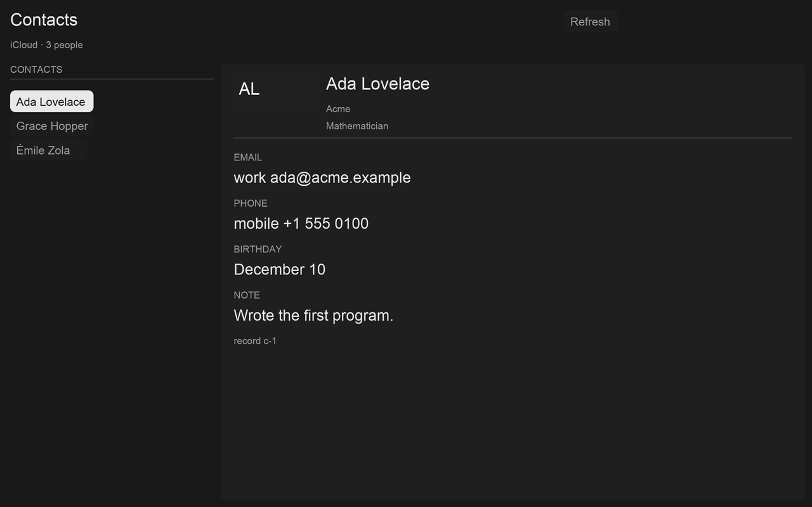

<p align="center">
  
</p>

<h1 align="center">Skykeep</h1>

<p align="center"><strong>iCloud, set free.</strong><br>Notes, Reminders, Calendar, Contacts, iCloud Drive and Photos as native apps on Windows, Linux and Android. Free and open source, in sync with your iPhone, iPad and Mac.</p>

<p align="center">
  <a href="https://github.com/YashwanthKamireddi/Skykeep/releases/latest"><strong>Download</strong></a> ·
  <a href="#install">Install</a> ·
  <a href="#engineering">How it works</a> ·
  <a href="#private-by-design">Privacy</a> ·
  <a href=".github/CONTRIBUTING.md">Contribute</a>
</p>

<p align="center">
  <a href="ARCHITECTURE.md"></a>
  <a href="#install"></a>
  <a href="https://github.com/YashwanthKamireddi/Skykeep/releases"></a>
  <a href="https://github.com/YashwanthKamireddi/Skykeep/actions/workflows/ci.yml"></a>
  <a href="https://github.com/YashwanthKamireddi/Skykeep/releases/latest"></a>
  <a href="LICENSE"></a>
</p>

<p align="center"><a href="https://apps.microsoft.com/detail/9P6B042JNK54"></a>&nbsp;&nbsp;<a href="https://snapcraft.io/skykeep"></a></p>

<p align="center"><b>Android:</b> <a href="https://github.com/YashwanthKamireddi/Skykeep/releases/latest/download/Skykeep-android.apk">download the APK</a> · <b>Linux:</b> <a href="#install">all packages</a></p>

Skykeep keeps your iCloud on your computer and phone, in sync with your iPhone, iPad and Mac. Every app opens instantly and works offline. Underneath is a small Rust engine that idles at under 0.1% of a CPU core.

<p align="center"><picture><source media="(prefers-color-scheme: dark)" srcset="docs/media/hero-dark.webp"></picture></p>

## Your iCloud, as apps

Six apps, each with its own icon in your launcher and Start menu and a window of its own. Click a picture to see it full size.

<table>
  <tr>
    <td width="50%" valign="top"><p align="center"><br><b>Skykeep Notes</b><br><sub>Checklists, tables, drawings and #tags.</sub></p><a href="docs/media/notes-light.webp"><picture><source media="(prefers-color-scheme: dark)" srcset="docs/media/notes-dark.webp"></picture></a></td>
    <td width="50%" valign="top"><p align="center"><br><b>Skykeep Reminders</b><br><sub>Smart lists, subtasks, tags and alerts.</sub></p><a href="docs/media/reminders-light.webp"><picture><source media="(prefers-color-scheme: dark)" srcset="docs/media/reminders-dark.webp"></picture></a></td>
  </tr>
  <tr>
    <td width="50%" valign="top"><p align="center"><br><b>Skykeep Calendar</b><br><sub>Day to year views, drag to edit, time zones. Nextcloud and CalDAV calendars beside iCloud’s.</sub></p><a href="docs/media/calendar-light.webp"><picture><source media="(prefers-color-scheme: dark)" srcset="docs/media/calendar-dark.webp"></picture></a></td>
    <td width="50%" valign="top"><p align="center"><br><b>Skykeep Contacts</b><br><sub>Every field, lists, merging, vCard and CSV.</sub></p><a href="docs/media/contacts-light.webp"><picture><source media="(prefers-color-scheme: dark)" srcset="docs/media/contacts-dark.webp"></picture></a></td>
  </tr>
  <tr>
    <td width="50%" valign="top"><p align="center"><br><b>Skykeep Drive</b><br><sub>Previews, resumable downloads, a real folder.</sub></p><a href="docs/media/drive-light.webp"><picture><source media="(prefers-color-scheme: dark)" srcset="docs/media/drive-dark.webp"></picture></a></td>
    <td width="50%" valign="top"><p align="center"><br><b>Skykeep Photos</b><br><sub>Albums, Shared Library, Live Photos, videos.</sub></p><a href="docs/media/photos-light.webp"><picture><source media="(prefers-color-scheme: dark)" srcset="docs/media/photos-dark.webp"></picture></a></td>
  </tr>
</table>

## Beyond the apps

**Send to iPhone.** Right-click any file and choose Send to iPhone: photos land in Photos, documents in Files, wherever the phone is. Nothing to install on the iPhone.

**Back up iCloud.** Every original photo and video, and all of iCloud Drive, copied to a folder or drive you choose and kept current. Changed files keep their earlier version, and a backup never deletes.

**iCloud in your file manager.** iCloud Drive and Photos are real folders in File Explorer and on Linux, with thumbnails before anything downloads.

## As fungOS spores

Skykeep's sync engine now feeds a host that is not Skykeep. `quince-soil` reads the
library and writes what a fungOS host already understands — records in `soil:records`,
photo bytes as content ids — and three Spores draw it.

| Spore | id | reads |
|---|---|---|
| [icloud-contacts](spores/icloud-contacts) | `org.skykeep.contacts` | `fungos.contacts/contact` |
| [icloud-calendar](spores/icloud-calendar) | `org.skykeep.calendar` | `fungos.calendar/event` |
| [icloud-photos](spores/icloud-photos) | `org.skykeep.photos` | `fungos.photos/*` |



The shape is the same for all three: Apple talks to `quince-*`, `quince-*` writes one
SQLite library, `quince-soil` projects that library into records, and a Spore reads the
records. The Spore never holds a token, never opens a socket, and never names a path.

[`spores/README.md`](spores/README.md) is the map,
[`spores/VFS-CID.md`](spores/VFS-CID.md) is the one host addition photos still needs, and
[`docs/photos-store.md`](docs/photos-store.md) is what a photo record contains and why.

## Installing the Spores

### Installing a package

A package installs with the host's own command, `soil-install`, which is not a Spore: it
fetches nothing by itself, verifies the tar's lock, writes the tree and records what it
replaced so the change can be rolled back.

```sh
# from a local .spore file
soil-install install ./icloud-contacts.spore --root ~/.local/share/fungos/spores

# from a store index, by the tar's CID (the store's own path)
soil-install install --cid ipfs://bafkreifrjraduygp3fo2gfwttvzmc6d2epcm6zqaunqd74ojbmpjt7e6iu \
  --index ~/.local/share/fungos/store/index.json \
  --packages ~/.local/share/fungos/store/packages \
  --root ~/.local/share/fungos/spores

soil-install status --root ~/.local/share/fungos/spores --json
soil-install rollback --id org.skykeep.contacts --root ~/.local/share/fungos/spores
```

Installing all three from this checkout, as run for this cut:

```console
$ soil-install install icloud-contacts.spore --root /tmp/fungos-spores
installed org.skykeep.contacts 0.1.0 (6b28c79545886baa244c45aaf1af8283a88d3bc26b4c25e818fbaefc0ef41243) previous=none
$ soil-install install icloud-calendar.spore --root /tmp/fungos-spores
installed org.skykeep.calendar 0.1.0 (312a83e9122fe923b74ea7cc3c9bbdc3b09e05e46763a97e8cd6e6c6ff763fe2) previous=none
$ soil-install install icloud-photos.spore --root /tmp/fungos-spores
installed org.skykeep.photos 0.1.0 (3c459290adeacf2db32176f6beb2a1c163a387ef464ff5ae00617890dde9426a) previous=none
```

`install` accepts an unsigned package; `apply` (index → fleet, with rollback) requires a
signed index and a publisher keyring unless `--allow-unsigned-dev` says otherwise. This fork
has no publisher key yet, so a release should `soil-spore sign` its tars before publishing
them.

What is still missing for a *store* install, in the sense of clicking Get in a storefront:

1. A store client on the host — `soil-store serve` and its index exist, and `soil-install`
   can install from one by CID, but no Spore is allowed to call either yet
   (`soil:spore.install` is a host capability, and the store Spore's grants still deny it).
2. A publisher key, so the signature is real rather than absent.
3. Pinning: see below.

### Artwork and pinning

The artwork a listing cites is content-addressed and reproducible from this checkout:

```sh
python3 tools/spore-cid.py --check   # every ipfs:// in a manifest is a file in the repo
python3 tools/spore-cid.py docs/media/spore-contacts.png
```

Changing a screenshot means re-running that and pasting the new id, which is the whole
point of the check: a listing that cites bytes nobody can reproduce is a listing nobody
can verify.

Nothing is pinned to an IPFS node yet, so the tars and screenshots are files here and
CIDs in a manifest, not bytes a peer can fetch. A release pins them; until then, install
from the `.spore` file on disk, which is what the commands above do.

### From this checkout

Build, check, pack, install — the whole path, from the soil repo's tools:

```sh
# in the soil checkout: the two host tools this needs
cargo build --release -p soil-spore -p soil-install

rustup target add wasm32-wasip2
for spore in icloud-contacts icloud-calendar icloud-photos; do
  (cd spores/$spore \
    && cargo build --release --target wasm32-wasip2 \
    && cp target/wasm32-wasip2/release/*.wasm module.wasm \
    && soil-spore lock . \
    && soil-spore check . --publish \
    && soil-spore pack . -o "$PWD/$spore.spore" \
    && soil-install install "$PWD/$spore.spore" --root ~/.local/share/fungos/spores)
done
```

`check --publish` passing means the package could be listed (manifest, module, view,
manual, artwork as CIDs, a reason on every grant); a human still has to read it. `pack`
writes the tar a store would distribute, and `soil-spore verify <file>.spore` checks one
back from its bytes alone.

The three packages this checkout builds, as of this cut:

| package | lock digest | tar CID |
|---|---|---|
| `icloud-contacts` | `6b28c79545886baa…` | `bafkreifrjraduygp3fo2gfwttvzmc6d2epcm6zqaunqd74ojbmpjt7e6iu` |
| `icloud-calendar` | `312a83e9122fe923…` | `bafkreieey53evhxmlk7gjiwndmzdjhbqzr242vek3qlsrablh7fhi2fci4` |
| `icloud-photos` | `3c459290adeacf2d…` | `bafkreighihu4ylaig2yp5ffzkpmfat7ib76hzpmmdpcynnzk5z6n6bisdi` |

Those are reproducible from these bytes, not published anywhere: nothing is pinned to an
IPFS node yet, so the tars are files until a release pins them.

Then point the host's spore root at the packages — a host reads a directory of packages,
so a symlink is enough (`~/.local/share/fungos/spores/` is the default root the store's
own documentation uses):

```sh
ln -s "$PWD/spores/icloud-contacts" ~/.local/share/fungos/spores/icloud-contacts
```

### Filling the records

A Spore is a reader, so nothing appears in it until the sync half has written records.
There are two sync halves, and the second needs no Apple ID at all:

```sh
# 1. Let Skykeep sync iCloud, as usual. That fills its library.
# 2. Project the library into records a host can read. SKYKEEP_DATA is the folder that
#    holds library.db (Linux: ~/.local/share/<bundle id>, macOS: ~/Library/Application
#    Support/<bundle id>), and the photo cache is the photos/ folder inside it.
quince-soil export --data "$SKYKEEP_DATA" --cache "$SKYKEEP_DATA/photos" \
                   -o /tmp/library.json
# 3. Hand them to the records host (the ingest sink soil already has).
export SOIL_RECORDS_TOKEN="$(head -c 32 /dev/urandom | base64)"
soil-records-ingest --root ~/.local/share/fungos/records \
                    --token-env SOIL_RECORDS_TOKEN --listen 127.0.0.1:8791 &
curl -sS -X POST http://127.0.0.1:8791/api/records/batch \
     -H "Authorization: Bearer $SOIL_RECORDS_TOKEN" \
     --data-binary @/tmp/library.json
```

Contacts and calendars land in the system books (`contacts`, `calendar`), so an iCloud
contact opens in the contacts Spore and one typed there is readable here. Photos land in
`photos`, because a photo is not a value — [`docs/photos-store.md`](docs/photos-store.md)
is that contract.

### Without an Apple ID

The Mac in front of you is already signed in, and it keeps most of what iCloud holds on
disk. Reading it is a file problem, not a login one:

```sh
# Contacts: 2 records from AddressBook-v22.abcddb, no session involved.
quince-soil macos-contacts --data ~/Library/Application\ Support/AddressBook

# Photos: 22,683 assets, 40 albums, 19,649 previews — metadata and pictures that are
# already here, hashed and chunked for the ingest sink above.
quince-soil macos-photos --library ~/Pictures/Photos\ Library.photoslibrary --chunks /tmp/photos
```

What the Mac has is what iCloud has already downloaded: an Optimize Storage library keeps
every preview (3.5 GiB here) and few originals, so a record carries the preview's content
id and the CloudKit name to hydrate the original by. Calendars are the exception — they are
not mirrored to disk — so they still need the sign-in above.

## Engineering

A native Rust engine with a light Tauri window on top, one codebase for Linux and Windows on x86 and ARM, and the same engine inside the Android app.

- Every screen reads a local SQLite library, never the network, so apps open instantly and work offline.
- Changes from your iPhone arrive over Apple's own push channel as they happen.
- Edits show at once and go through an outbox: sent in order, held while offline, safe to send twice.
- Notes merge through Apple's own CRDT, so typing on two devices at once keeps both edits.
- Apple's SRP sign-in with two-factor is rebuilt in Rust. Your password is never sent.
- The engine's DNS resolver cannot look up a host that isn't Apple's.
- Each release passes over 1,300 Rust tests and is installed and launched on Ubuntu, Debian, Mint, Fedora, openSUSE, Arch and Windows before it ships.

[ARCHITECTURE.md](ARCHITECTURE.md) has the full tour.

## Private by design

- No Skykeep servers, accounts, analytics or crash reports. Your iCloud goes only between your device and Apple.
- Your session lives in the system keyring (the Android Keystore on a phone), and your library in a folder only you can read.
- Nextcloud and CalDAV calendars can sit beside iCloud's, on a connection locked to your own server.
- Open source, built in public, with checksums and signature-checked updates.

[SECURITY.md](SECURITY.md) shows the code behind each point.

## On Android

Reminders, Notes, Photos and iCloud Drive as apps, and your iCloud contacts and calendars inside Android's own Contacts and Calendar, synced both ways. iCloud Drive also appears in the Files app. Same engine as the desktop, offline-first, talking only to Apple.

<p align="center"><a href="docs/media/android/home-light.webp"><picture><source media="(prefers-color-scheme: dark)" srcset="docs/media/android/home-dark.webp"></picture></a></p>

[Download the APK](https://github.com/YashwanthKamireddi/Skykeep/releases/latest/download/Skykeep-android.apk) · Android 10 or newer, 64-bit ARM

## Install

| Platform | Installation |
|---|---|
| **Windows** | [Microsoft Store](https://apps.microsoft.com/detail/9P6B042JNK54), or the [installer](https://github.com/YashwanthKamireddi/Skykeep/releases/latest/download/Skykeep-windows-x64-setup.exe). Also `choco install skykeep` and [Scoop](https://github.com/YashwanthKamireddi/scoop-bucket) |
| **Linux stores** | [Snap Store](https://snapcraft.io/skykeep)<br>Fedora and Fedora Asahi: `sudo dnf copr enable yashonfed/skykeep && sudo dnf install skykeep`<br>Arch: `yay -S skykeep` |
| **Linux files** | [`.deb`](https://github.com/YashwanthKamireddi/Skykeep/releases/latest/download/Skykeep-linux-amd64.deb) ([ARM](https://github.com/YashwanthKamireddi/Skykeep/releases/latest/download/Skykeep-linux-arm64.deb)), [`.rpm`](https://github.com/YashwanthKamireddi/Skykeep/releases/latest/download/Skykeep-linux-x86_64.rpm) ([ARM](https://github.com/YashwanthKamireddi/Skykeep/releases/latest/download/Skykeep-linux-aarch64.rpm)), or the [AppImage](https://github.com/YashwanthKamireddi/Skykeep/releases/latest/download/Skykeep-linux-x86_64.AppImage) for any other Linux |
| **Android** | The [APK](https://github.com/YashwanthKamireddi/Skykeep/releases/latest/download/Skykeep-android.apk) from GitHub Releases |

Every file and its checksum is on the [latest release](https://github.com/YashwanthKamireddi/Skykeep/releases/latest). The stores, the Windows installer and the AppImage update themselves; for a `.deb` or `.rpm`, install the new one over the old.

<details>
<summary>Commands for each Linux file, and fixes for Fedora, openSUSE and the AppImage</summary>

```sh
sudo apt install ./Skykeep-linux-amd64.deb                          # Ubuntu, Debian, Mint
sudo dnf install ./Skykeep-linux-x86_64.rpm                         # Fedora
sudo zypper install --allow-unsigned-rpm ./Skykeep-linux-x86_64.rpm # openSUSE Tumbleweed
chmod +x Skykeep-linux-x86_64.AppImage && ./Skykeep-linux-x86_64.AppImage
sudo snap install skykeep && sudo snap connect skykeep:password-manager-service
```

The Snap's second command lets it keep you signed in through your keyring. On Ubuntu the AppImage needs `libfuse2t64` once (`libfuse2` on 22.04). Fedora and openSUSE leave out the decoder for iPhone photos (HEIC) for patent reasons: on Fedora, enable RPM Fusion and `sudo dnf install libheif-freeworld`; on openSUSE, add Packman and install `libheif1`. For Drive and Photos as folders on Arch, also `sudo pacman -S fuse3`.
</details>

## Official downloads

Skykeep comes only from the links above. The AUR packages are community-maintained builds of these releases. The Android APK is signed with this certificate (SHA-256):

```
61:0A:64:50:6D:95:DA:6C:CE:75:FF:0E:40:B8:59:02:FA:41:E4:0D:00:1B:BA:87:BF:40:70:FE:CB:F2:3A:FB
```

## Sign in

Sign in with your Apple Account and approve it on your iPhone, iPad or Mac, as for icloud.com. Each app fills in as your library arrives.

Using Advanced Data Protection? Turn on **Access iCloud Data on the Web** first (iPhone: Settings, your name, iCloud).

## Questions

<details>
<summary>How do I use iCloud and Apple Notes on Linux?</summary>

Install Skykeep (see [Install](#install)) and sign in with your Apple Account. Apple makes no iCloud app for Linux; Skykeep gives you Notes, Reminders, Calendar, Contacts, iCloud Drive and Photos as native apps there, kept on your computer and in sync with your iPhone. iCloud Drive and Photos also appear as folders in your file manager.
</details>

<details>
<summary>Can I use Apple Notes and Reminders on Windows?</summary>

Yes. Apple's own iCloud for Windows has no Notes or Reminders app; Skykeep has both, with checklists, tables, smart lists and alerts, alongside Calendar, Contacts, iCloud Drive and Photos. Get it from the Microsoft Store, Chocolatey, Scoop or the installer on the [releases page](https://github.com/YashwanthKamireddi/Skykeep/releases/latest).
</details>

<details>
<summary>How do I get iCloud Notes and Reminders on Android?</summary>

Install the [APK](https://github.com/YashwanthKamireddi/Skykeep/releases/latest/download/Skykeep-android.apk) and sign in with your Apple Account. Notes, Reminders, Photos and iCloud Drive open as apps; your iCloud contacts and calendars appear in Android's own Contacts and Calendar.
</details>

<details>
<summary>Is Skykeep made by Apple?</summary>

No. It's an independent, open-source app that works with iCloud. Apple, iCloud and iPhone are trademarks of Apple Inc.
</details>

<details>
<summary>How is this different from iCloud for Windows?</summary>

iCloud for Windows brings Photos and iCloud Drive to File Explorer, and Calendar and Contacts through Outlook. Skykeep has Notes and Reminders too, all six as apps of their own in your launcher, works offline, and runs on Linux as well.
</details>

<details>
<summary>Why does it need my Apple Account password?</summary>

Notes, Reminders, Drive and Photos open only to a full sign-in with two-factor, as on icloud.com. Skykeep proves your password with SRP instead of sending it, and keeps it in your system keyring; signing out erases it.
</details>

<details>
<summary>Is it safe to use with my Apple Account?</summary>

Skykeep signs in the way icloud.com does, with your password and two-factor code, and talks only to Apple (plus any calendars or servers you add yourself, and GitHub's release servers in builds that update themselves). Apple has no official API for Notes, Reminders, Drive or Photos, so Skykeep uses the same web services icloud.com uses, as icloudpd has for years. Apple can change them at any time and may occasionally ask you to sign in again.
</details>

<details>
<summary>How do I send a diagnostics log?</summary>

Quit Skykeep and start it with `SKYKEEP_LOG=1 skykeep` (Windows PowerShell: `$env:SKYKEEP_LOG=1`, then `skykeep.exe`). It writes `diagnostics.log` in its data folder with the addresses it asked and Apple's answer codes, never passwords, tokens or anything from your library. Attach it to a [bug report](https://github.com/YashwanthKamireddi/Skykeep/issues/new?template=bug_report.yml).
</details>

## Contributing

Bug reports, packaging for your distro, design ideas and code are all welcome. [CONTRIBUTING.md](.github/CONTRIBUTING.md) has the setup and a map of the code, and [Discussions](https://github.com/YashwanthKamireddi/Skykeep/discussions) is the place for questions and ideas. Security problems go to a [private report](https://github.com/YashwanthKamireddi/Skykeep/security/advisories/new).

## License

Skykeep is free and open source under the [GPL-3.0](LICENSE).

Copyright (C) 2026 Yashwanth Kamireddi. Not affiliated with Apple Inc. Apple, iCloud and iPhone are trademarks of Apple Inc.

Everything this fork adds is under the same licence: `crates/quince-soil` (the records
bridge) and the three Spores under `spores/` are GPL-3.0-only, because they are derived
from Skykeep's window code and its engine. That is a boundary, not a formality — the Spores
cannot be copied into a repository under another licence without the whole combined work
moving to the GPL. [`NOTICE`](NOTICE) records what was derived from what.

